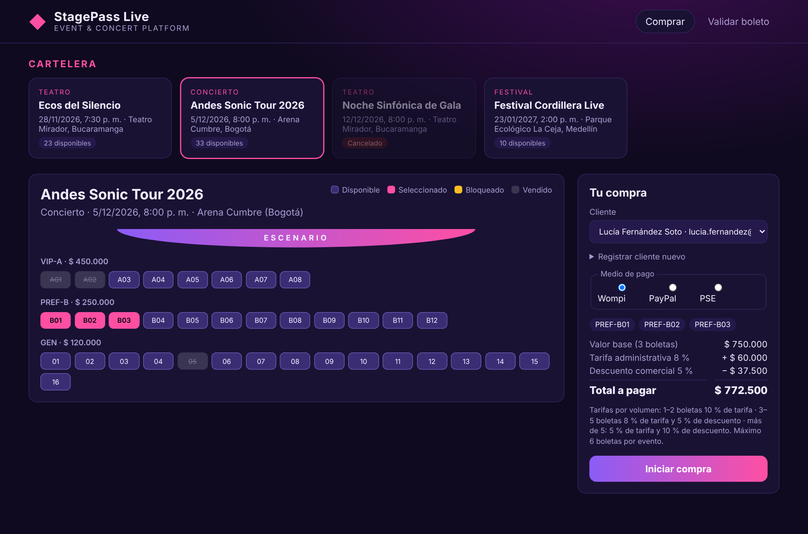
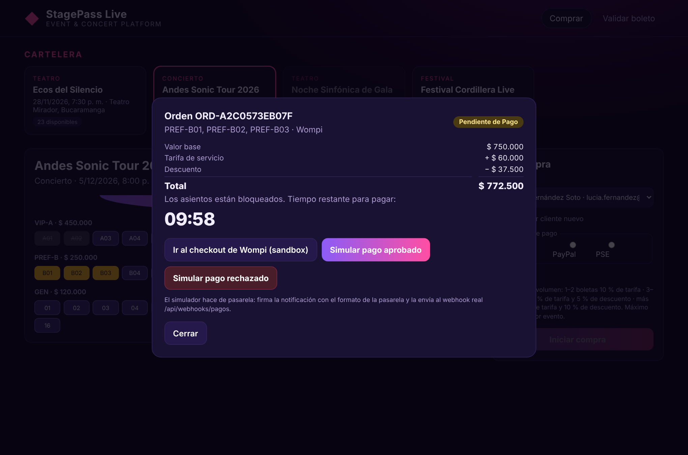
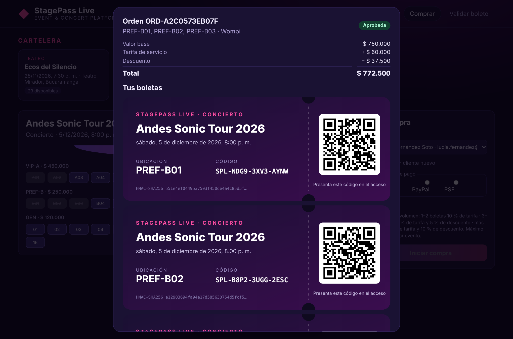
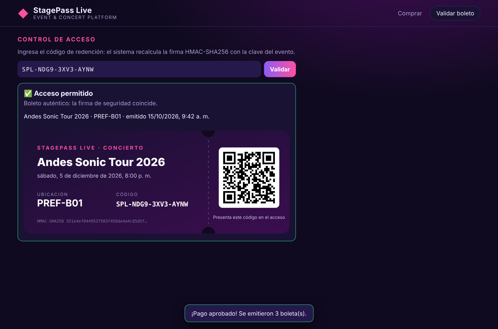

# 🎫 StagePass Live — Event & Concert Platform

**Taller: Arquitectura Hexagonal** · Arquitectura de Software · Universidad Autónoma de Bucaramanga (UNAB)  
Docente: MSc. Feisar Moreno

Integrantes:
- Juan Camilo Calderón
- Santiago Steven Ruiz

Plataforma web de venta y expedición de boletería digital para conciertos, festivales y teatro, construida con **Arquitectura Hexagonal (Puertos y Adaptadores)**. Las reglas de negocio (tarifas dinámicas, bloqueo temporal de asientos y emisión de boletas firmadas) viven en un núcleo que **no depende de ningún framework, base de datos ni API externa**.

| Capa | Tecnología |
|---|---|
| Núcleo (dominio + casos de uso + puertos) | TypeScript puro — cero dependencias |
| Adaptadores primarios | Express 4 (REST + webhooks), temporizador de Node.js |
| Adaptadores secundarios | Wompi (**real**), Generador HMAC‑SHA256 + QR (**real**); MySQL, MongoDB, PayPal, PSE, WhatsApp, SendGrid y DIAN (**dummies**) |
| Interfaz web | HTML, CSS y JavaScript |
| Pruebas | `node:test` (46 pruebas) |

---

## 📐 Diagrama de clases UML

Elaborado en **Draw.io**. Está organizado en los paquetes del hexágono: adaptadores primarios, puertos primarios, casos de uso, puertos secundarios, adaptadores secundarios y dominio. Incluye clases, atributos, métodos, relaciones y dependencias.

> 🔍 **Para hacer zoom:** haz clic en el diagrama y se abre a tamaño completo. Es un SVG, así que las líneas son vectoriales y el texto se mantiene nítido al acercarse. También puedes abrir el [archivo editable de Draw.io](docs/diagramas/Diagrama-Clases-UML.drawio) en [app.diagrams.net](https://app.diagrams.net).

[](docs/diagramas/Diagrama-Clases-UML.svg)

Archivos: [SVG](docs/diagramas/Diagrama-Clases-UML.svg) · [PNG](docs/diagramas/Diagrama-Clases-UML.png) · [Draw.io editable](docs/diagramas/Diagrama-Clases-UML.drawio)

| Elementos del diagrama | Cantidad |
|---|---|
| Clases, interfaces y enumeraciones | 104 |
| Conectores | 65 |
| · Realización (implementa) | 23 |
| · Dependencia «use» | 21 |
| · Asociación | 11 |
| · Generalización (hereda) | 9 |
| · Composición | 1 |

**Leyenda de colores:** 🟨 dominio · 🟪 casos de uso · 🟦 puertos (interfaces) · 🟩 adaptadores implementados (Wompi y generador HMAC/QR) · ⬜ adaptadores dummy · 🟥 excepciones de negocio.

---

## 🖥️ Capturas del sitio

| 1. Selección de asientos y cotización | 2. Orden creada: asientos bloqueados 10 minutos |
|---|---|
|  |  |
| El núcleo calcula tarifa y descuento por volumen (3 boletas: 8 % de tarifa y 5 % de descuento). | Orden en *Pendiente de Pago* con cuenta regresiva; los asientos quedan bloqueados (ámbar). |

| 3. Pago aprobado: boletas emitidas | 4. Control de acceso: validación del boleto |
|---|---|
|  |  |
| Webhook de Wompi verificado → orden aprobada → boletas con código QR y firma HMAC‑SHA256. | Se recalcula la firma con la clave del evento: si el boleto fue alterado, se niega el acceso. |

---

## Cómo ejecutarlo

Requisito: Node.js 20 o superior.

```bash
npm install
npm start          # http://localhost:3000
npm test           # 46 pruebas: dominio, casos de uso, adaptadores, arquitectura y HTTP
npm run typecheck  # verificación de tipos con TypeScript
```

**Probar una compra completa:**
1. Elige un evento y selecciona asientos. La cotización la calcula el núcleo.
2. Elige un cliente y un medio de pago y pulsa **Iniciar compra**: los asientos quedan bloqueados 10 minutos.
3. Pulsa **Simular pago aprobado**. El simulador hace de pasarela: arma el evento con el formato real de Wompi, lo firma y lo envía por HTTP al webhook `/api/webhooks/pagos/wompi`.
4. Se emiten las boletas con su código QR. En la pestaña **Validar boleto**, el código se verifica recalculando la firma HMAC.

---

## Estructura hexagonal

```
src/
├── nucleo/                          ◀ INSIDE: sin frameworks ni librerías
│   ├── dominio/
│   │   ├── modelo/                  Evento, Recinto, Asiento, Cliente, Orden, Boleto, enumeraciones, objetos de valor
│   │   ├── servicios/               PoliticaTarifas, PoliticaBloqueoAsientos, PoliticaLimiteBoletas, ContenidoFirmableBoleto
│   │   └── excepciones/             errores de negocio
│   ├── puertos/
│   │   ├── entrada/                 8 puertos primarios (interfaces de casos de uso)
│   │   └── salida/                  12 puertos secundarios (repositorios y servicios externos)
│   └── aplicacion/                  8 casos de uso que implementan los puertos primarios
│
├── infraestructura/                 ◀ OUTSIDE: adaptadores
│   ├── entrada/
│   │   ├── rest/                    Express: controladores REST + endpoint de webhooks de pago
│   │   └── programador/             tarea que libera reservas vencidas
│   ├── salida/
│   │   ├── pagos/wompi/             ✅ REAL  — AdaptadorPasarelaWompi
│   │   ├── pagos/paypal/            dummy    — AdaptadorPayPalDummy
│   │   ├── pagos/pse/               dummy    — AdaptadorPseDummy
│   │   ├── boletos/                 ✅ REAL  — GeneradorCredencialesHmacQr
│   │   ├── persistencia/mysql/      dummy    — repositorios legacy de eventos, recintos y asientos
│   │   ├── persistencia/mongodb/    dummy    — repositorios de clientes, órdenes y boletas
│   │   ├── notificaciones/          dummy    — WhatsApp y SendGrid
│   │   ├── facturacion/             dummy    — DIAN
│   │   └── sistema/                 reloj e identificadores
│   ├── configuracion/contenedor.ts  raíz de composición (inyección de dependencias)
│   └── desarrollo/                  simulador de pasarelas (solo desarrollo)
└── main.ts
public/                              interfaz web
tests/                               pruebas automatizadas
docs/diagramas/                      diagrama de clases UML (.drawio y PNG)
```

**Regla de dependencias:** el código de `nucleo/` solo importa archivos de `nucleo/`. Los adaptadores importan puertos y tipos del dominio, nunca al revés. Solo `contenedor.ts` conoce a la vez los casos de uso concretos y los adaptadores, y los conecta por constructor. Esto lo verifican automáticamente las pruebas de `tests/arquitectura.test.ts`.

---

## Requisitos del taller y dónde se cumplen

| Requisito | Implementación |
|---|---|
| Soberanía del núcleo | `src/nucleo` no importa librerías, frameworks ni módulos de Node (prueba *Núcleo soberano*). |
| Inversión de dependencias (DIP) | Los casos de uso reciben interfaces (`RepositorioOrdenes`, `PasarelaPago`…) por constructor. `contenedor.ts` inyecta los adaptadores. |
| Entidades como objetos puros | `nucleo/dominio/modelo`: clases sin anotaciones. |
| Puertos con tipos del dominio | `nucleo/puertos`: solo interfaces. Ninguna firma expone `Request`, SQL ni DTOs de pasarelas (prueba automática). |
| Adaptadores sin lógica de negocio | No importan casos de uso ni políticas del dominio (prueba automática). |
| Adaptador primario: compra desde navegador o app | `ControladorCompras` → `IniciarCompraCasoUso`, `CotizarCompraCasoUso`. |
| Adaptador primario: notificaciones de pasarelas | `ControladorWebhooksPago` (`POST /api/webhooks/pagos/:pasarela`) → `ConfirmarPagoCasoUso`. |
| Persistencia dual MySQL + MongoDB | Puertos `RepositorioEventos/Recintos/Asientos` (MySQL legacy) y `RepositorioClientes/Ordenes/Boletos` (MongoDB). |
| Puerto común de pasarelas | `PasarelaPago { registrarPago, recibirConfirmacion }` con adaptadores Wompi, PayPal y PSE. |
| Representación gráfica y criptográfica | Puerto `GeneradorCredencialesBoleto` → `GeneradorCredencialesHmacQr` (HMAC‑SHA256 + QR en SVG). |
| Notificaciones WhatsApp y correo | Puerto `Notificador` → `NotificadorWhatsAppDummy`, `NotificadorSendGridDummy`. |
| Factura electrónica DIAN | Puerto `FacturadorElectronico` → `FacturadorDianDummy`. |
| Al menos dos adaptadores completos | **Wompi** y **GeneradorCredencialesHmacQr**, ambos con pruebas propias. |

### Reglas de negocio

| Regla | Dónde |
|---|---|
| Bloqueo de 10 minutos y liberación automática | `PoliticaBloqueoAsientos`, `Orden.estaVencida`, `LiberarReservasExpiradasServicio` + `ProgramadorLiberacionReservas` (cada 30 s) y liberación perezosa al consultar o comprar. |
| Tarifa y descuento por volumen (1–2: 10 % / 0 %; 3–5: 8 % / 5 %; más de 5: 5 % / 10 %) | `PoliticaTarifas.liquidar` |
| Máximo 6 boletas por cliente y evento | `PoliticaLimiteBoletas`: cuenta las órdenes aprobadas y las pendientes vigentes. |
| Boleta solo con pago exitoso y verificado | `Boleto.emitir` exige orden aprobada. `ConfirmarPagoServicio` exige firma de la pasarela válida, transacción aprobada, monto igual al total y bloqueo vigente. |
| Hash a partir de datos inmutables y clave del evento | `ContenidoFirmableBoleto` define qué se firma; `GeneradorCredencialesHmacQr` firma con HMAC‑SHA256 y la clave secreta del evento. |

### Decisiones de diseño

1. **HMAC‑SHA256 como función de hash.** Viene incluido en `node:crypto` (fácil de implementar). A diferencia de un SHA‑256 simple, sin la clave secreta del evento nadie puede fabricar una firma válida.
2. **Datos firmados:** `STAGEPASS-v1 | orden | cliente | evento | asiento | ubicación | total de la orden | código | fecha de emisión`. Si se altera cualquiera de ellos, la validación falla.
3. **Total = valor base + tarifa − descuento.** Ambos porcentajes se calculan sobre el valor base de las boletas.
4. **Estado del asiento por función.** El mismo asiento físico puede estar vendido en un evento y libre en otro.
5. **Concurrencia optimista.** El repositorio de asientos solo cambia el estado si sigue siendo el esperado. Así dos compradores no bloquean el mismo asiento.
6. **Compensación.** Si la pasarela falla al registrar el cobro, se liberan los asientos y la orden queda rechazada.
7. **Pago tardío o repetido.** Si el pago llega después de los 10 minutos, la orden expira y se marca `requiereReembolso`. Si la pasarela reenvía la misma notificación, no se duplican boletas.
8. **Observación sobre el enunciado:** con el límite de 6 boletas por cliente, la tarifa corporativa (más de 5) solo aplica a compras de exactamente 6 boletas.

---

## API REST

| Método | Ruta | Puerto primario |
|---|---|---|
| GET | `/api/eventos` | ConsultarCatalogoCasoUso |
| GET | `/api/eventos/:id/asientos` | ConsultarCatalogoCasoUso |
| GET / POST | `/api/clientes` | GestionarClientesCasoUso |
| POST | `/api/cotizaciones` | CotizarCompraCasoUso |
| POST | `/api/ordenes` | IniciarCompraCasoUso |
| GET | `/api/ordenes/:id` | ConsultarOrdenCasoUso |
| POST | `/api/webhooks/pagos/:pasarela` | ConfirmarPagoCasoUso |
| GET | `/api/boletos/validar/:codigo` | ValidarBoletoCasoUso |
| GET | `/api/boletos/:id/representacion` | ValidarBoletoCasoUso (SVG con QR) |

Errores: `400` datos inválidos · `401` firma de pasarela inválida · `404` no existe · `409` asiento no disponible, límite excedido o evento no disponible · `502` falla de la pasarela.

### Configuración de Wompi (sandbox)

| Variable | Uso |
|---|---|
| `WOMPI_LLAVE_PUBLICA` | Llave pública `pub_test_…` |
| `WOMPI_SECRETO_INTEGRIDAD` | Firma de integridad del checkout |
| `WOMPI_SECRETO_EVENTOS` | Verificación del checksum de los webhooks |
| `URL_BASE` | URL pública del servidor (para registrar el webhook en Wompi) |
| `SIMULADOR_PASARELAS=false` | Desactiva el simulador en producción |

---

## Declaración de uso de IA

| Campo | Detalle |
|---|---|
| Herramienta | Claude (Anthropic) |
| Versión del modelo | Claude Opus 5.5 |
| Momento de uso | _(completar)_ |
| Prompts principales | _(completar)_ |
| Aportes propios del equipo | _(completar: revisión, pruebas, ajustes y decisiones)_ |
